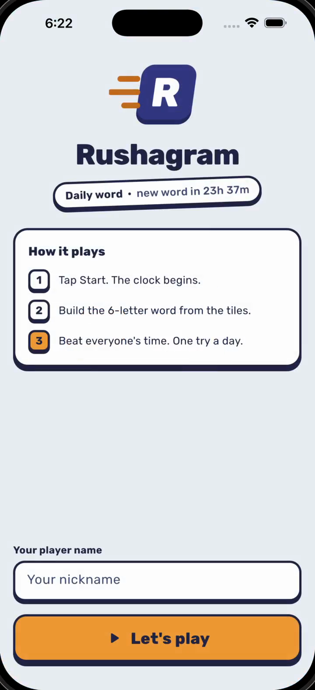
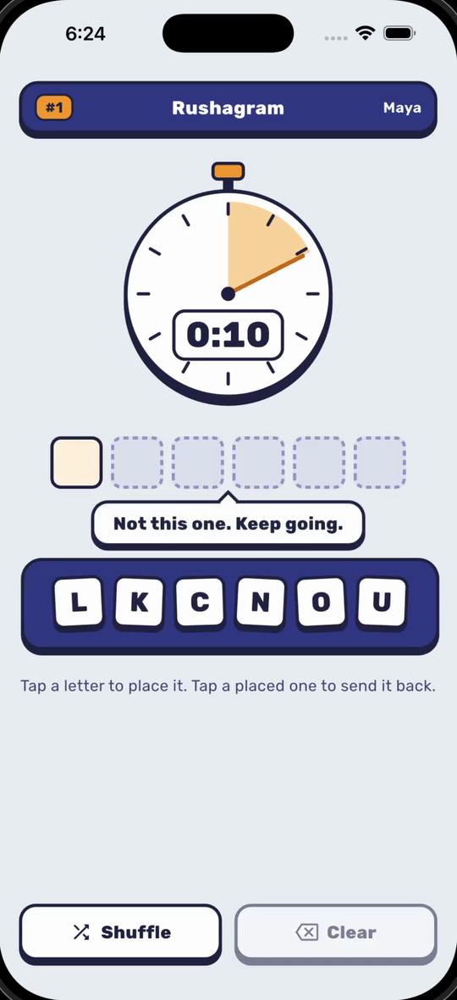
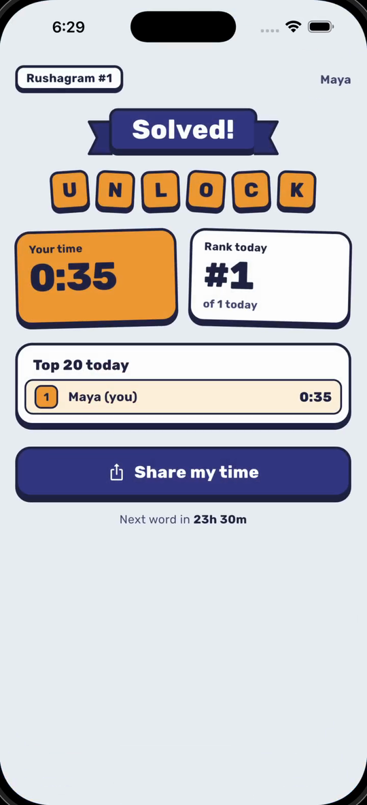

<div align="center">

<picture>
  <source media="(prefers-color-scheme: dark)" srcset="https://assets.appambit.com/logo-dark.svg">
  <source media="(prefers-color-scheme: light)" srcset="https://assets.appambit.com/logo-light.svg">
  
</picture>

<br><br>


# Rushagram — the word of the day against the clock (Flutter)

**One word puzzle a day, the same for everyone. Six scrambled letters, a stopwatch, one run. Solve it and see your
time and your rank in the world today. The puzzle, the clock and the ranking live on [AppAmbit](https://appambit.com)
— no server of your own, no login.**

App **03 / 07** of the *7 apps in 7 days* series — built with **one prompt**.


[](https://www.facebook.com/profile.php?id=61583377906035)
[](https://www.instagram.com/appambit/)
[](https://www.youtube.com/@AppAmbit)

</div>

---

## Contents

- [What this is](#what-this-is)
- [Built with one prompt](#built-with-one-prompt)
- [Quick start](#quick-start)
- [Backend setup (AppAmbit)](#backend-setup-appambit)
- [How AppAmbit drives the app](#how-appambit-drives-the-app)
- [What's included](#whats-included)
- [Make it yours](#make-it-yours)
- [Project structure](#project-structure)
- [Commands](#commands)
- [Troubleshooting](#troubleshooting)
- [Learn more](#learn-more)
- [Follow AppAmbit](#follow-appambit)

## What this is

- **Pick a nickname and play.** No accounts: the phone identifies itself.
- **One puzzle a day for everyone.** At midnight UTC AppAmbit picks the word; every iPhone and Android phone gets the
  same six scrambled letters.
- **The word never leaves the cloud.** Phones only get the letters; every guess is checked in Cloud Code.
- **Fair clock.** Start and finish times come from the database clock, not the phone, so nobody can cheat the timer.
- **Your rank in the world today** — *"Solved in 0:23 — #14 in the world today"* — plus the top 20 and a share button.
- **A morning push** reminds everyone that today's word is ready.

<div align="center">

| Pick a nickname | Race the clock | Your rank today |
|:---:|:---:|:---:|
|  |  |  |
| *One word a day, no account.* | *Six tiles, a real stopwatch.* | *Time, rank and the top 20.* |

</div>

> Real captures from an iPhone. Design: **"Arcade sticker"** — every tile, card and button is a sticker with a thick outline; the clock is a real
> stopwatch. Details in [DESIGN.md](DESIGN.md).

## Built with one prompt

The whole app — backend, game, morning notification and tests — was built with **one prompt** sent to a coding agent
(Claude Code) with the **AppAmbit MCP** connected. It's in **[`prompts.md`](prompts.md)**, ready to paste:

| Step | Where | What it builds |
|---|---|---|
| 0 | By hand | The AppAmbit apps and their keys, Firebase `google-services.json`, push credentials |
| 1 | Agent + AppAmbit MCP + Flutter | Everything: backend, the game, the morning notification, tests, a real test on two phones |

## Quick start

**Prerequisites:** Flutter with Dart `^3.11`, Xcode and/or Android Studio, an
[AppAmbit account](https://appambit.com) with **Database**, **Cloud Code** and **Push** enabled, and a Firebase
project (Android push only).

```bash
git clone <your fork> rushagram && cd rushagram
cp .env.example .env     # fill in both App Keys
flutter pub get
flutter run
```

`.env` (git-ignored, never commit it):

```
APPAMBIT_IOS_APP_KEY=<your iOS app key>
APPAMBIT_ANDROID_APP_KEY=<your Android app key>
```

### Push credentials (by hand, once)

- **Android:** in Firebase add an Android app with your package, download `google-services.json` to `android/app/`
  (git-ignored) and upload the service account JSON to your Android app in AppAmbit. See AppAmbit's
  [FCM requirements](https://docs.appambit.com/push-notifications/fcm-requirements/).
- **iOS:** create an APNs key (**Sandbox & Production**) and upload the `.p8` to your iOS app in AppAmbit with its
  Key ID, Team ID and bundle id.

## Backend setup (AppAmbit)

Paste the prompt in [`prompts.md`](prompts.md) with the AppAmbit MCP connected and the agent creates all of this.

### Database — `RushagramDb`

Linked to **both** apps, so everyone plays the same letters and shares one ranking. Run once in the SQL editor:

1. [`cloud_functions/schema.sql`](cloud_functions/schema.sql) — 4 tables and the rank index.
2. [`cloud_functions/seed_words.sql`](cloud_functions/seed_words.sql) — 500 common, family-friendly 6-letter words,
   each with only one possible answer ([`words.txt`](cloud_functions/words.txt)).

### Cloud Code

Full contract in **[cloud_functions/README.md](cloud_functions/README.md)**.

| Function | Trigger | Does |
|---|---|---|
| `today` | HTTP, both apps | Today's letters, the server time, your run if you have one |
| `start_run` | HTTP, both apps | Starts your one run of the day (time from the database clock) |
| `submit_guess` | HTTP, both apps | Checks the word; if right, returns your time, rank and the top 20 |
| `ranking` | HTTP, both apps | Your result and the top 20 |
| `pick_word` | Schedule `0 0 * * *`, one app | Picks the day's word at 00:00 UTC |
| `morning_push` | Schedule `0 14 * * *`, both apps (+ HTTP to test) | "Today's Rushagram is ready." to every player |

- **Push per app:** `ctx.appambit.push` only reaches phones of the app the function runs in, so `morning_push` is
  deployed to each app with the env var `PLATFORM` = `ios` / `android`.
- **Lazy pick:** if the schedule doesn't fire, the first call of the day picks the puzzle (`INSERT OR IGNORE`, so a
  race is safe).

## How AppAmbit drives the app

```
00:00 UTC  pick_word ──► puzzles (word stays in the cloud)
14:00 UTC  morning_push ──► 🔔 every player, iOS and Android

Phone ──► today ────────► scrambled letters + server time
      ──► start_run ────► started_at  (database clock)
      ──► submit_guess ─► wrong → shake · right → time_ms, rank, top 20
                                               "Solved in 0:23 — #14 in the world today"
```

## What's included

| Area | Where |
|---|---|
| Nickname screen | `lib/features/player/` |
| Daily puzzle, stopwatch, tiles, result and ranking | `lib/features/daily/` |
| AppAmbit Cloud Code, Push, Analytics and diagnostics | `lib/core/appambit/` |
| Arcade sticker theme and shared widgets | `lib/core/theme/`, `lib/core/widgets/` |
| Logo, wordmark and icon sources | `assets/branding/` |
| Cloud Code sources, schema, words and tests | `cloud_functions/` |

## Make it yours

- **App keys** — your own, in `.env`.
- **Words** — change `cloud_functions/words.txt` and `seed_words.sql` (one word per row, `INSERT OR IGNORE`, safe to
  run again).
- **Push time** — the `morning_push` schedule (14:00 UTC = 8 am Mexico City).
- **App name** — `ios/Runner/Info.plist` (`CFBundleDisplayName`) and `android/app/src/main/AndroidManifest.xml`
  (`android:label`).
- **Bundle id / applicationId** — `com.kavaup.rushagram`. It must match your Firebase app and your APNs key.
- **Icon and splash** — replace the files in `assets/branding/`, then run `dart run flutter_launcher_icons` and
  `dart run flutter_native_splash:create`.

## Project structure

```
lib/
  main.dart
  core/
    appambit/          # cloud_service · push_service · analytics · diagnostics
    theme/             # Arcade sticker tokens
    widgets/           # stickers, buttons, banners
  features/
    player/            # nickname
    daily/             # the puzzle, the stopwatch, the result and the ranking
cloud_functions/       # 6 functions · schema.sql · seed_words.sql · words.txt · tests
assets/branding/       # icon, mark, wordmark
test/                  # unit and widget tests
```

## Commands

| Command | Does |
|---|---|
| `flutter pub get` | Install dependencies |
| `flutter run` | Run on a device or simulator |
| `flutter analyze` | Lint |
| `flutter test` | Dart tests |
| `node --test cloud_functions/*.test.mjs` | Cloud Code tests against an in-memory SQLite |
| `dart run flutter_launcher_icons` | Regenerate the app icon |
| `dart run flutter_native_splash:create` | Regenerate the splash screen |

## Troubleshooting

| Symptom | Fix |
|---|---|
| No letters on start | `schema.sql` / `seed_words.sql` not run, or `today` has no HTTP trigger. |
| Only one platform gets the morning push | `morning_push` must be deployed to **both** apps, each with its own `PLATFORM`. |
| The schedule never fires | The lazy pick in `today` still creates the puzzle; test the push through its HTTP trigger. |
| No push on iOS from Xcode | The APNs key must be **Sandbox & Production**. |

## Learn more

- [prompts.md](prompts.md) — the one prompt the app was built with
- [cloud_functions/README.md](cloud_functions/README.md) — every function's contract
- [DESIGN.md](DESIGN.md) — the look
- [AGENTS.md](AGENTS.md) — rules for coding agents
- [AppAmbit](https://appambit.com) · [AppAmbit docs](https://docs.appambit.com) · [Flutter docs](https://docs.flutter.dev)

## Follow AppAmbit

New apps every week, built on AppAmbit with an AI agent:

- **Facebook** — [facebook.com/AppAmbit](https://www.facebook.com/profile.php?id=61583377906035)
- **Instagram** — [@appambit](https://www.instagram.com/appambit/)
- **YouTube** — [@AppAmbit](https://www.youtube.com/@AppAmbit)

---

<div align="center"><sub>Built with Flutter + AppAmbit. One prompt, a real app with a backend.</sub></div>
